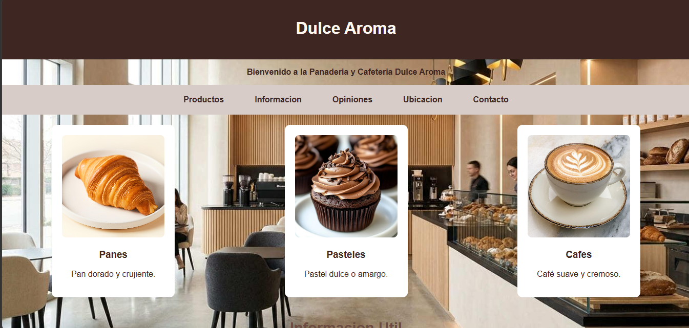
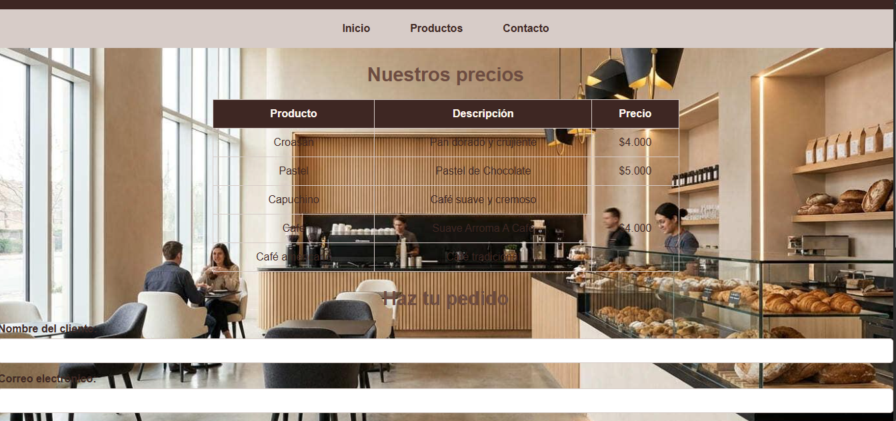
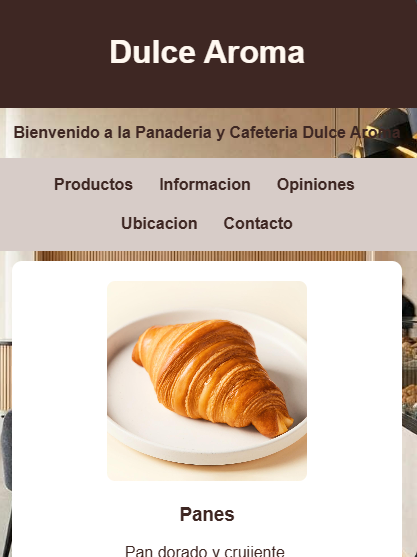
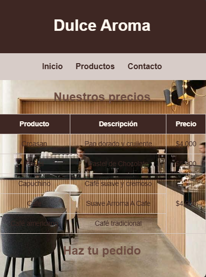

# Dulce Aroma | Panadería y Cafetería

## 1. El proyecto

**Dulce Aroma** es un sitio web para una panadería y cafetería que ofrece panes, pasteles y bebidas como café y capuchino.

El sitio está dirigido a personas que desean conocer los productos del negocio, consultar sus precios, revisar opiniones de otros clientes y realizar pedidos.

El objetivo del proyecto es ofrecer una página sencilla, organizada y adaptable a diferentes dispositivos, para que los clientes encuentren la información del establecimiento fácilmente.

### Necesidades del cliente

- Mostrar los productos principales de la panadería.
- Informar sobre los horarios de atención y recomendaciones.
- Presentar las opiniones de los clientes.
- Facilitar la consulta de precios.
- Permitir que los usuarios diligencien un formulario para realizar pedidos.
- Mostrar la ubicación del establecimiento mediante Google Maps.
- Facilitar la navegación desde computadores y celulares.

## 2. Estructura del proyecto

La estructura del repositorio está organizada de la siguiente manera:

```text
Dulce-Aroma/
├── index.html
├── contacto.html
├── README.md
├── css/
│   └── style.css
├── imagen/
│   ├── fondo.jpg
│   ├── croasan.jpg
│   ├── pastel.jpg
│   └── capuchino.jpg
└── capturas/
    ├── escritorio-inicio.png
    ├── escritorio-contacto.png
    ├── movil-inicio.png
    └── movil-contacto.png
```

Las carpetas y los archivos tienen las siguientes funciones:

- `index.html`: contiene la página principal, los productos, la información útil, las opiniones y la ubicación.
- `contacto.html`: contiene la tabla de precios y el formulario para realizar pedidos.
- `css/style.css`: reúne los estilos visuales utilizados por las dos páginas.
- `imagen/`: almacena las fotografías de los productos y la imagen de fondo.
- `capturas/`: almacena las imágenes utilizadas para documentar el diseño en escritorio y celular.
- `README.md`: explica el funcionamiento, la estructura y las decisiones técnicas del proyecto.

### Etiquetas semánticas utilizadas

**`<header>`:** contiene el encabezado principal y el nombre del negocio, Dulce Aroma.

**`<nav>`:** agrupa los enlaces que permiten navegar entre las secciones y las páginas del sitio.

**`<section>`:** organiza el contenido en bloques temáticos. Por ejemplo, `id="Productos"` agrupa las tarjetas de productos y `id="Ubicacion"` contiene el mapa.

**`<article>`:** representa cada producto de manera independiente, con su imagen, nombre y descripción.

**`<footer>`:** contiene información final del establecimiento y enlaces para regresar al inicio o contactar al negocio.

**`<table>`, `<th>` y `<td>`:** presentan los precios en filas y columnas para facilitar su lectura.

**`<form>`, `<label>` e `<input>`:** permiten recoger los datos necesarios para elaborar un pedido.

**`<blockquote>` y `<cite>`:** se utilizan para mostrar las opiniones de los clientes y sus nombres.

**`<iframe>`:** incorpora el mapa de Google Maps dentro de la página.

## 3. Sistema visual

El diseño utiliza colores cálidos relacionados con el café, el pan y los productos de una panadería.

### Paleta de colores

| Color | Código | Uso |
|---|---|---|
| Café oscuro | `#3E2723` | Encabezado, botones y enlaces del pie de página |
| Crema | `#FFF8F0` | Fondo base y texto claro |
| Beige grisáceo | `#D7CCC8` | Fondo de la navegación y bordes de la tabla |
| Café medio | `#6D4C41` | Títulos secundarios y efectos al pasar el cursor |
| Blanco | `white` | Fondo de las tarjetas de productos |

### Tipografía

El sitio utiliza la familia:

```css
font-family: Arial, Helvetica, sans-serif;
```

Elegí estas fuentes porque son fáciles de leer y están disponibles en la mayoría de los dispositivos.

Los títulos secundarios utilizan un tamaño de `1.8rem`, que se reduce a `1.5rem` en pantallas de hasta 600 píxeles de ancho.

### Espaciado y presentación

El CSS utiliza propiedades como `padding`, `margin` y `gap` para separar los elementos y evitar que el contenido se vea amontonado.

Por ejemplo:

```css
article {
    background-color: white;
    padding: 20px;
    margin: 20px auto;
    border-radius: 10px;
    max-width: 300px;
    text-align: center;
}
```

El relleno separa el contenido de los bordes, el margen crea espacio exterior y `border-radius` redondea las esquinas de las tarjetas.

La imagen de fondo utiliza `background-size: cover` para cubrir el área disponible sin deformar la imagen.

## 4. Especificidad en CSS

La especificidad determina qué selector tiene prioridad cuando varias reglas aplicables establecen valores diferentes para una misma propiedad.

Se representa mediante la siguiente notación:

**(IDs, clases y pseudoclases, etiquetas y pseudoelementos).**

### Conflicto 1: tamaño máximo de las tarjetas

En la hoja de estilos existe esta regla:

```css
article {
    max-width: 300px;
}
```

Dentro de la consulta para dispositivos móviles aparece:

```css
@media (max-width: 600px) {
    article {
        max-width: 350px;
    }
}
```

**Cálculo de especificidad:**

- `article`: `(0, 0, 1)`.
- `article` dentro de `@media`: `(0, 0, 1)`.

Ambas reglas tienen la misma especificidad. Cuando la consulta de medios está activa, gana la segunda declaración porque aparece después en la hoja de estilos.

En pantallas de hasta 600 píxeles, el ancho máximo de la tarjeta pasa de 300 a 350 píxeles.

**Captura requerida:** abrir las herramientas de desarrollador, seleccionar una tarjeta y mostrar la propiedad `max-width` en el panel Estilos. La declaración perdedora debe aparecer tachada.

### Conflicto 2: tamaño de los títulos secundarios

En el CSS general:

```css
h2 {
    font-size: 1.8rem;
}
```

En el diseño para celulares:

```css
@media (max-width: 600px) {
    h2 {
        font-size: 1.5rem;
    }
}
```

**Cálculo de especificidad:**

- `h2`: `(0, 0, 1)`.
- `h2` dentro de `@media`: `(0, 0, 1)`.

Los selectores tienen la misma especificidad. Gana la regla que aparece después cuando se cumple la condición de la consulta de medios.

Esto permite que los títulos sean más pequeños en pantallas reducidas.

**Captura requerida:** seleccionar un título `<h2>` en el inspector y mostrar las dos declaraciones de `font-size`, con la regla perdedora tachada.

### Conflicto 3: ancho máximo del mapa

En el CSS general:

```css
#Ubicacion iframe {
    max-width: 100%;
}
```

En la consulta para celulares:

```css
@media (max-width: 600px) {
    iframe {
        max-width: 100%;
    }
}
```

**Cálculo de especificidad:**

- `#Ubicacion iframe`: `(1, 0, 1)`.
- `iframe`: `(0, 0, 1)`.

Gana `#Ubicacion iframe` porque contiene un selector de ID. Su especificidad es mayor, aunque la regla general aparezca antes.

En este ejemplo, ambas declaraciones tienen el mismo valor, por lo que no se produce un cambio visual. Sin embargo, el inspector permite observar cuál selector tiene prioridad.

**Captura requerida:** seleccionar el mapa y mostrar `max-width` en el panel Estilos. Si el navegador presenta la declaración de menor especificidad tachada, incluir esa captura.

### Importancia del orden de las reglas

Los conflictos entre las dos reglas de `article` y las dos reglas de `h2` muestran que, cuando los selectores tienen igual especificidad, el orden puede decidir qué declaración gana. La consulta de medios aparece al final de la hoja de estilos, por lo que sus valores se aplican cuando se cumple la condición y no existe otra prioridad superior.

## 5. Herencia en CSS

La herencia permite que algunas propiedades de un elemento padre se transmitan a sus descendientes.

### Propiedad que se hereda: `color`

En el CSS general:

```css
body {
    color: #3E2723;
}
```

Esta propiedad establece el color de texto predeterminado para muchos elementos descendientes, como párrafos y listas, siempre que no exista otra regla que establezca un color diferente.

Por ejemplo, el texto de la información útil utiliza el color heredado del elemento `body`, salvo que otra regla lo modifique.

### Propiedad que no se hereda: `padding`

En el encabezado:

```css
header {
    padding: 20px;
}
```

El espacio interior de 20 píxeles pertenece al encabezado. No se transmite automáticamente a los párrafos, enlaces u otros elementos que se encuentren dentro de él.

Esto permite controlar el espacio de cada componente de forma independiente.

## 6. Modelo de cajas

El modelo de cajas se compone de contenido, relleno (`padding`), borde (`border`) y margen (`margin`).

Para calcular el ancho de una tarjeta de producto en el diseño general, se toma como referencia la regla:

```css
article {
    padding: 20px;
    max-width: 300px;
}
```

Si el contenido ocupa el ancho máximo de 300 píxeles y no se establece un borde, el cálculo es:

| Elemento | Ancho |
|---|---:|
| Contenido | 300 px |
| Padding izquierdo | 20 px |
| Padding derecho | 20 px |
| Bordes | 0 px |
| **Ancho exterior de la caja** | **340 px** |

La fórmula es:

`300 + 20 + 20 + 0 = 340 px`

Este cálculo no incluye los márgenes exteriores.

El resultado corresponde al modelo predeterminado `content-box` de CSS, siempre que no exista otra regla que modifique `box-sizing`.

### Márgenes

La tarjeta utiliza:

```css
margin: 20px auto;
```

Los 20 píxeles corresponden a los márgenes superior e inferior, mientras que `auto` distribuye el espacio horizontal disponible para centrarla cuando las condiciones de ancho lo permiten.

Los márgenes verticales de elementos de bloque pueden colapsar en determinadas situaciones. Sin embargo, no se debe afirmar que los márgenes de las tarjetas se solapan sin comprobar la estructura y el comportamiento real del diseño.

### Mejora posible

Para facilitar el cálculo del ancho en dispositivos pequeños, se puede utilizar:

```css
* {
    box-sizing: border-box;
}
```

Con esta regla, el ancho declarado incluye el contenido, el relleno y el borde, lo que ayuda a evitar desbordamientos.

## 7. Selectores y pseudoclases estructurales

Las pseudoclases estructurales permiten seleccionar elementos según su posición entre sus hermanos.

En la hoja de estilos original se utilizan selectores de ID, de elemento y pseudoclases como `:hover`. Sin embargo, `:hover` representa un estado de interacción y no una posición estructural.

Para demostrar una pseudoclase estructural, se puede añadir al final del CSS:

```css
#Productos article:first-child {
    border: 2px solid #6D4C41;
}
```

Esta regla selecciona el primer elemento `<article>` que sea hijo de `#Productos`. En el HTML actual corresponde a la tarjeta de panes.

`first-child` comprueba si el elemento es el primer hijo de su padre, no si es el primer elemento de un tipo específico. En este caso, los tres artículos están agrupados directamente dentro de la sección de productos.

Si se desea seleccionar el primer artículo aunque existan otros tipos de elementos hermanos antes de él, puede utilizarse `:first-of-type`:

```css
#Productos article:first-of-type {
    border: 2px solid #6D4C41;
}
```

Esta regla también selecciona el primer `<article>` entre sus hermanos del mismo tipo.

## 8. Diseño responsive

El sitio utiliza una consulta de medios para adaptar la presentación a pantallas de hasta 600 píxeles de ancho:

```css
@media (max-width: 600px) {
    header {
        padding: 15px 10px;
    }

    nav {
        flex-wrap: wrap;
        gap: 5px;
    }

    nav a {
        padding: 8px;
    }

    #Productos {
        flex-direction: column;
        align-items: center;
    }

    article {
        width: 90%;
        max-width: 350px;
        margin: 10px auto;
    }

    h2 {
        font-size: 1.5rem;
    }

    form {
        width: 100%;
        padding: 10px;
    }

    iframe {
        max-width: 100%;
    }

    table {
        font-size: 0.85rem;
    }
}
```

### Cambios principales

- El encabezado reduce su relleno para aprovechar mejor el espacio.
- La navegación permite que los enlaces pasen a varias líneas cuando sea necesario.
- Las tarjetas de productos se organizan en una columna y quedan centradas.
- Los títulos secundarios reducen su tamaño.
- El formulario ocupa el ancho disponible para facilitar su uso.
- El mapa limita su ancho para adaptarse al contenedor.
- La tabla reduce el tamaño del texto para aprovechar el espacio horizontal.

El objetivo es que las páginas puedan consultarse tanto en computadores como en celulares sin perder legibilidad.

Se debe comprobar el resultado a 360 píxeles de ancho, ya que una tabla o una tarjeta con relleno adicional puede producir desbordamiento si el ancho total no se controla.
## 9. Capturas de pantalla

Las siguientes imágenes deben guardarse dentro de la carpeta `capturas/` y añadirse al repositorio.

### Página principal en escritorio



### Página de contacto y precios en escritorio



### Página principal a 360 píxeles



### Página de contacto y precios a 360 píxeles



Las imágenes deben corresponder a capturas reales del sitio. Los nombres anteriores son los nombres de archivo propuestos para mantener el repositorio organizado.

### Cómo tomar las capturas

1. Abrir la página en Google Chrome.
2. Presionar `F12` para abrir las herramientas de desarrollador.
3. Activar la barra de dispositivos con `Ctrl + Shift + M`.
4. Seleccionar un ancho de 360 píxeles para las capturas móviles.
5. Tomar las capturas de cada página y guardarlas en la carpeta `capturas/`.
6. Para las capturas de escritorio, desactivar la barra de dispositivos y utilizar una ventana amplia.
7. Para los conflictos de especificidad, abrir el panel **Elements > Styles** y capturar la regla ganadora junto con la declaración perdedora tachada.

## Publicación del sitio

Si el proyecto se publica con GitHub Pages, el enlace se debe añadir aquí:

**Sitio publicado:** [Agregar aquí la URL real de GitHub Pages]

## Autor

**Nombre:** Juan Sebastian Sierra Velasco

**Proyecto:** Dulce Aroma – Panadería y Cafetería

**Tecnologías utilizadas:** HTML5 y CSS3.


